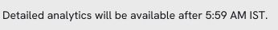

# Campaign Reports

This document outlines the reporting capabilities available in Sortment, explains how to navigate to reports, defines key analytics terms, and clarifies how custom tracking events are integrated into reporting.

***


The campaign reports on Sortment are built using the campaign data on your warehouse. There is an hourly sync to update analytics.


### 1. Overview of reports

Once a campaign is sent via Sortment, a post-campaign report is generated automatically. This report provides insight into how the campaign performed across various user engagement stages.

#### Available charts and tables

* **Campaign Summary:** Quick stats such as total sent, opens, clicks, conversions.
* **Click Tracking Table:** detailed breakdown of all links included in the campaign with outputs like total clicks and unique clicks.
* **Audience Exclusion Table:** Shows users excluded from delivery due to global unsubscribes, subscription group preferences, null data validation or frequency capping.
* **Funnel Chart:** A step-by-step drop-off visualization of the campaign (Sent → Delivered → Opened → Clicked → Converted).
* **Performance Over Time:** Time-series analysis of open, click, and conversion events.
* **Aggregated Time Analysis:** Breakdown by hour, day, or week for identifying peak interaction windows.
* **Custom Tracking Events:** If configured, additional user events such as “Product Viewed” or “Added to Cart” are included.

***

### 2. Accessing the reports dashboard

To view analytics for any campaign:

1. Navigate to the Campaigns tab in the Sortment dashboard.
2. Locate the desired campaign.
3. Click the ellipsis icon (⋯) on the top-right of the campaign tile.
4. Select View Report from the dropdown.

This will open the report view for the selected campaign.

***

### **3. Report sections explained**

**3.1 Click tracking report**

* A detailed list of all links clicked by users, showing:
  * **Link URL**
  * **Total clicks**: Total times each link was clicked.
  * **Unique clicks**: Number of unique users who clicked the link.
  * Percentages next to each value indicate what fraction of total clicks that link represents.
* **Use case**: Understand user interest by analyzing which content or product links were most engaging.

**3.2 Audience exclusions summary**

This section outlines how many users were excluded from the campaign due to:

* **Global unsubscribes**: Users who opted out of all communications on the channel.
* **Subscription group unsubscribes**: Users opted out of specific categories (e.g., newsletters, promos).
* **Null check failures**: Users dropped due to missing required profile data (send to value like email, phone respectively).
* **Frequency capping exclusions**: Users skipped due to limits on how often they can be contacted.

#### **3.3 Funnel chart**

The funnel chart illustrates user progression through five stages:

* **Sent**: Total emails dispatched.
* **Delivered**: Emails that reached inboxes.
* **Opened**: Emails that were opened.
* **Clicked**: Users who clicked on any links.
* **Converted**: Users who completed a predefined conversion goal (e.g., signup, purchase).

Use the funnel to identify bottlenecks or drop-offs in engagement.

***

#### **3.4 Performance over time**

Displays how user activity evolves post-send:

* Tracks opens, clicks, and conversions over time.
* Helps analyze time-based responsiveness and campaign shelf-life.

**Note**: If data is missing or seems delayed, verify sync status and ensure campaign filters are correctly applied.

***

#### **3.5 Aggregated time performance**

Shows cumulative open, click, and conversion events over time to show a trend in how user activity trends over time in a campaign

### Why can I see sends before detailed analytics are available?

Open the campaign and choose **View analytics**. If you see the “Detailed analytics will be available after” notice, you can already check sends and send skips. The time in the notice uses your workspace timezone and marks the earliest the detailed report can open.

<figure><figcaption>
The report can still be waiting for a warehouse refresh after the displayed time.
</figcaption></figure>

For campaigns showing this notice, at least 30 minutes must pass after the send, and the campaign event data must refresh successfully in the warehouse after the send. For example, if you send at 09:00 and the first successful refresh finishes at 09:45, detailed analytics can appear at 09:45. If the notice persists, check the last successful campaign event refresh before comparing conversion counts.

### Why do conversions differ from another report?

Start by comparing one email campaign run in both reports. A journey can include several messages, while a single campaign report covers the selected campaign. For a recurring campaign, **All Runs** includes more than one send once the campaign has repeated; choose the corresponding run to compare one send.

Check the conversion goal and its tracking window in the campaign settings. A report that counts every order in a calendar month answers a different question from one that counts recipients who completed the campaign’s goal within its tracking window.

Finally, compare the counts behind the percentages. For the email campaign [Conversion Rate](glossary.md), the denominator is unique emails delivered. For example, 10 converted recipients out of 200 unique deliveries is 5%. A report using 250 attempted sends would show 4% for the same 10 people. Match the goal, time window, run and denominator before investigating missing events.
