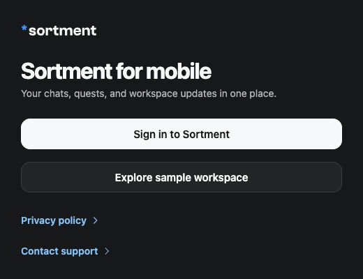

# Use Sortment on mobile

Open [Sortment for mobile](https://chat.sortment.com/mobile/) to follow chats, quests, and workspace updates in your browser. You can also explore a sample workspace before signing in.

## Sign in and choose a workspace

Use a Sortment account with access to a workspace on this site. If you need an invitation, contact your workspace administrator.

1. Open [chat.sortment.com/mobile/](https://chat.sortment.com/mobile/).
2. Select **Sign in to Sortment** and complete your account's sign-in flow.
3. If **Choose a workspace** appears, select the workspace you want to open.

Sortment opens the workspace home. When available, it returns you to the workspace you last selected in the same browser tab.

<figure><figcaption>
The mobile web welcome screen.
</figcaption></figure>

## What can I open on mobile?

Use the tabs along the bottom of the workspace:

| Tab | What you can find |
| --- | --- |
| **Home** | Workspace updates, including insights, alerts, and items that need your input. |
| **Chats** | Existing conversations and **New chat**. |
| **Quests** | Goals, their progress, and requests for input. |
| **Artifacts** | Workspace documents and other saved outputs available to your account. |

Your access still depends on your workspace permissions. When a reply offers **Open this reply in Sortment web**, use it to view content that the mobile view cannot display.

Before you send a message or answer a quest request, read any confirmation shown. Mobile AI sharing is explained in [Manage mobile AI permission and account requests](../settings/mobile-privacy-and-account.md).

## Switch workspaces or open settings

1. Select the workspace name and initials at the top of the screen.
2. Select **Workspaces** to choose another workspace, or **App settings** to change the app's appearance.

The same menu includes **Sign out**. In the sample, this option is **Leave sample workspace**.

## Try the sample

On the welcome screen, select **Explore sample workspace**. The built-in **Fieldwork** example lets you inspect the mobile layout without an account. Its example conversations and results are separate from your live workspace.

## Troubleshooting

### My workspace is missing

Check that you signed in with the invited account. Ask your workspace administrator to confirm your access. If a linked workspace is unavailable, open one listed under **Workspaces** or contact [Sortment support](../getting-started/contact-us.md).

### A chat reply failed

If the failed reply offers **Try again**, select it to continue the conversation. If the problem repeats, contact support with the error text and what you were trying to do.

### I cannot sign in

Use **Contact support** on the welcome screen, or open [mobile support](https://chat.sortment.com/mobile/support.html). Include your device, browser, and the error message. If you use a native build, also include its app version.
