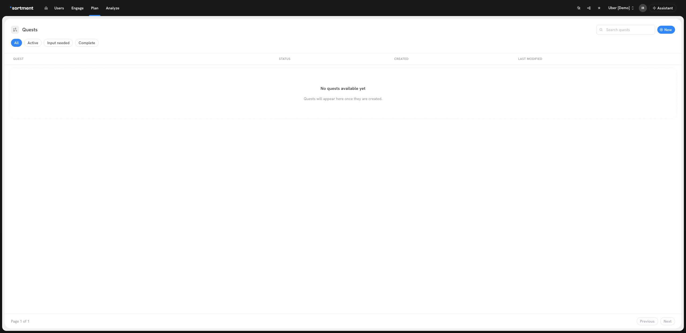

# Should I use a Quest, a Task, or a Journey?

Choose a **Quest** when you want Sortment AI to work toward a goal over several milestones. Choose a **Task** when you can name a piece of work you want repeated on a schedule. Choose a **Journey** when you want individual users to move through a defined flow.

| If you want to… | Use | What to expect |
| --- | --- | --- |
| Investigate why fewer new users complete onboarding and decide what to try next | **Quest** | A plan with milestones. Review the findings and give input on the next scope. |
| See a report on onboarding completion every Monday | **Task** | A report each time the scheduled instruction runs. |
| Send a reminder to eligible users who signed up but have not completed onboarding | **Journey** | Each qualifying user enters through a trigger and follows the configured delays, conditions and actions. |

## Where do I start?

- **Quest:** Open **Plan → Quests**. Choose **New** to start from a goal, or select **Input needed** to find existing Quests waiting for your input.
- **Task:** Describe the work and schedule in chat. For example: “Every Monday, report how many users completed onboarding last week.” See [Tasks](../using-sortment-ai/tasks.md) for scheduling and reports.
- **Journey:** Open **Engage → Journeys**. Define who enters, what happens next, and when users leave. See the [Journey Builder](../journeys/journey-builder.md) for triggers and actions.

<figure><figcaption>
Use Input needed when you want to review a Quest that is waiting on you.
</figcaption></figure>

## Can I use them together?

Yes. For example, use a Quest to investigate onboarding drop-off. If you decide to send a reminder, review the audience, content and delivery settings of the Journey before activating it. Use a Task if you also want a recurring report on the result. A Quest milestone report is not evidence that a Journey is active or that anyone received a message.
