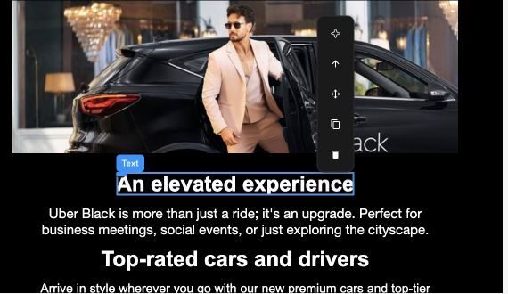
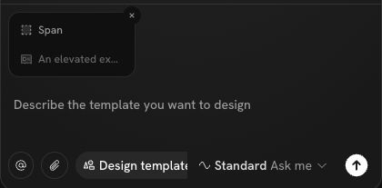

# Email templates with Sortment AI

Sortment lets you generate email templates using AI by describing your campaign goal and target audience

> Ensure your brand guidelines, email design, and style preferences have been configured in the **AI Intelligence** settings before using this feature.

***

#### Navigation

<figure><figcaption></figcaption></figure>

1. Hover over **Engage** in the left sidebar
2. Click on **Templates**
3. Select **Email**
4.  Click **Create New**

    <figure><figcaption></figcaption></figure>
5. The **New Template** panel opens with the AI prompt UI

<figure><figcaption></figcaption></figure>

> If you'd prefer to build the template manually, click **Start with a blank template** in the top-right corner of the panel.

***

#### Fill in the AI Prompt

The AI template builder has two required fields:

**What's the goal here?**

Describe the main objective of your email e.g., drive app installs, announce a new feature, win back inactive users.

* **Field:** `Describe the main objective`
* **Example:** `Re-engage users who haven't logged in for 30 days with a special discount offer`

**Who are the target users?**

Define the audience or segment this message is intended for.

* **Field:** `Describe the audience or segment`
* **Example:** `Mobile app users in the 25–40 age group who have made at least one purchase`

> ℹ️ Sortment AI will automatically refer to your brand tone and design preferences from your <mark style="color:$info;">knowledge base(intelligence blocks)</mark>. The more specific your inputs, the better the generated template will match your brand and campaign intent.

***

#### Optional Enhancements

Before generating, you can optionally add more context using the following add-ons:

| Add-on                | What it does                                                         |
| --------------------- | -------------------------------------------------------------------- |
| **+ Storyline**       | Provide a narrative arc or key messages you want the email to follow |
| **+ References**      | Attach reference content or links for AI to draw inspiration from    |
| **+ Personalization** | Specify personalization tokens or dynamic content to include         |

***

#### Generate the Template

Once your inputs are ready, click **Generate with AI** at the bottom of the panel.

Sortment AI will produce a fully designed email template based on your goal, audience, and any optional inputs provided.

***

#### Edit the Generated Template

After generation, the template opens directly in the email editor. You can:

* Edit copy, subject line, and layout manually or using the AI prompt box at the bottom of the screen.
* Swap or update images and CTAs
* Adjust styling to match your campaign needs

Review the updated design before using it in a campaign.

#### **Edit Using Sortment AI**

Use AI to revise a specific section, change the tone, or update content without starting a new design. Open the email you want to change so the assistant has the right editing context.

### Edit a specific part of an email

Save any manual edits you want to keep before asking AI to make another change.

1. Open the email you want to change. For a saved template, open **Design**. For a campaign, choose **Edit** in **Content**, then open **Design**. If the campaign has multiple variants, select the intended variant first.
2. Select the text, image, or section on the canvas, then choose the sparkle icon, **Edit with AI**.
3. Check the selected element in the assistant and describe the change. For example: “Shorten this heading to five words. Keep the rest of the email unchanged.”
4. Wait for the response, then check the design in the email you opened.

**Screenshot sequence**

<figure><figcaption>
1. Select the part of the email you want to change, then choose the sparkle icon.
</figcaption></figure>

<figure><figcaption>
2. Check that the selected element appears beside your prompt.
</figcaption></figure>

### Where does the AI edit go?

| Where you started | What to check |
| --- | --- |
| A saved template in the template library | The AI updates that template. Review the refreshed design and use **Edit history** to check the saved version. |
| The email inside a campaign | The AI can update the selected campaign variant directly. This edit does not create or update a template in the library. Review the campaign's own content. |
| An email that has not been saved, or an edit the AI could not apply directly | The AI may return a design for you to apply. Follow **Apply to Editor** below; the returned design is not yet a saved change. |

If you asked AI to create a separate library copy, check that copy in **Email Templates**. Creating the copy does not apply it to an existing campaign.

### What does Apply to Editor do?

When **AI has updated the template** appears with **Apply to Editor**, the returned design is ready to load into the canvas.

1. Choose **Apply to Editor**.
2. Review the content, links, personalization, fonts, and spacing. Use the mobile view to check the layout.
3. Choose **Save** and finish any save dialog.
4. Reopen the same template or campaign email to confirm the saved result.

**Apply to Editor** changes the canvas; you still need to save it. **Dismiss** closes the suggestion without applying it and does not undo an edit that the AI already saved directly.

If the AI reports an error and the original email is unchanged, check whether it supplied a design with **Apply to Editor**. If the result still cannot be applied or saved, keep the error text and contact Sortment support.

### How do I check what was saved?

Open **Engage → Templates**, choose **Email Templates**, and select the saved template by name. Use **Details** to check the subject and **Design** to inspect the content. In **Design**, the **Edit history** clock appears next to the name when the template has earlier versions or unsaved changes to an existing version. Open the clock and look for **Current** to identify the saved version. If you see **Your unsaved changes**, save the edits you want to keep before switching versions.

Select an older version to inspect its design. The preview is read-only and opening it does not change the template. Choose **Back to current version** to resume editing.

If you want the older design to become current, preview it first, then choose **Restore version**. This creates a new version from the selected one and keeps the intervening versions in history. Reopen **Edit history** to check which version is now current.
