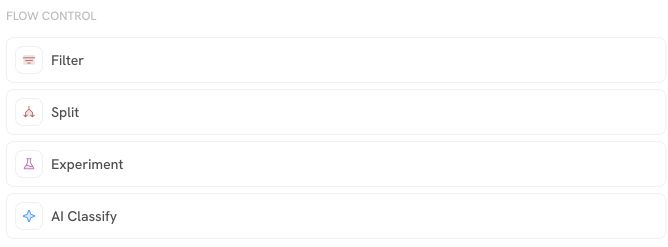

# Flow Control

Flow control blocks allow you to determine how users progress through a Journey based on attributes, behaviours, or experimentation logic. These steps dynamically shape user paths, enabling precise audience targeting and optimisation.

Choose a flow control block:

* Filter
* Split
* Experiment
* [AI Classify](#ai-classify)

***

## Filter

Use a **filter** step to evaluate users based on static or dynamic conditions. This step creates two distinct branches:

* **Qualified** – users who meet the filter criteria
* **Everyone else** – users who do not meet the criteria

<figure><figcaption></figcaption></figure>

#### Example use case

Filter users who:

* are on the “Premium” subscription plan **AND**
* have triggered the `app_opened` event within the past 7 days.

These users will continue down the **qualified** path, while others will be routed to **Everyone else**.

#### Configuration

1.  **User properties**

    Pick an existing audience or create one using related tables, events, and traits. (e.g., `subscription_plan = "Premium"`, `signup_date > 01-01-2025`, `Total Order Count > 25`, etc.).
2.  **Journey activity**

    Toggle on to filter users based on journey-related activity or dynamic behaviour (e.g., "has opened the app in the last 7 days").

<figure><figcaption></figcaption></figure>

***

## Split

A **split** step segments users into multiple branches based on the value of a selected property. This is commonly used to customise the experience for different user segments.

<figure><figcaption></figcaption></figure>

#### Configuration

1. **Split on:** Select a property to evaluate (e.g., `rating`, `region`, or `driver_status`).
2. **Define paths:** Create one or more conditions to group users into specific paths:
   * **Path 1**: `rating` is less than 2
   * **Path 2**: `rating` is between 2 and 4
   * **Path 3**: `rating` is greater than 4

Users are evaluated against these conditions in the order listed and routed accordingly. Any user who doesn't match a condition will follow the default **everyone else** path.

<figure><figcaption></figcaption></figure>

#### Example use case

Split users by satisfaction rating to deliver tailored follow-up experiences:

* <2: Show apology and collect feedback
* 2–4: Offer support tips
* 4 - 5: Prompt referral invitation

### Experiment

An **experiment** step enables randomised testing across multiple paths to measure and optimise user outcomes. This is useful for A/B or multivariate testing.

<figure><figcaption></figcaption></figure>

#### Example use case

Test two onboarding email sequences by splitting users 40/60. Track which sequence results in more app opens within 7 days, and automatically switch all future users to the winning version after 7 days.

#### Configuration

1.  **Variant distribution**

    Specify what percentage of users should go down each path (e.g., 40% to Path 1, 60% to Path 2). You can optionally add more paths or a control group.
2. **Conversion tracking**
   * **Conversion event**: Select the event that signifies success (e.g., `app_opened`).
   * **Tracking window**: Define how long to measure conversions (e.g., 7 days).
   * **Auto-switch to winning path**: Automatically route future users to the top-performing path after a fixed period (e.g., 12 days).
3. **Control group**\
   Set a percentage of users who do not receive anything from the experiment. This helps you to analyse the experiment on an absolute basis – how much did each variant do compared to users who did not receive any  communications.


The sum total percentages for all variants and control group should add up to 100%.


## AI Classify

Use **AI Classify** when the next step depends on what someone wrote. For example, a reply that says “Can I move my appointment to Friday?” could follow a **Reschedule** path, while “Tuesday still works” could follow a **Confirm** path. Place the block after the journey has received the reply you want to classify.

1. On the journey canvas, select **+** where you want to branch. Under **Flow control**, select **AI Classify**.
2. In **Rules to classify on**, describe the categories and what belongs in each. For the appointment example, enter “Use Reschedule when someone asks for a different time. Use Confirm when they accept their current time.”
3. Select **Generate**. Review **Guidance** and **Paths** to see how Sortment interpreted your rules. Select **Modify** if the categories overlap or a useful path is missing.
4. Connect each path to its next step. Give **Everyone else** a next step if the journey should continue when it has no matching classification.

<figure><figcaption>
Find AI Classify under Flow control when adding a journey step.
</figcaption></figure>

### What happens if classification takes too long?

Sortment tries a second classifier automatically if the first one fails. The journey waits up to the block’s timeout for a result. The default is **30 minutes**. If no result arrives in time, the contact continues without a label. A connected **Everyone else** path handles that case. If you leave it empty, the contact’s journey ends there.
