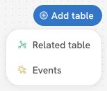
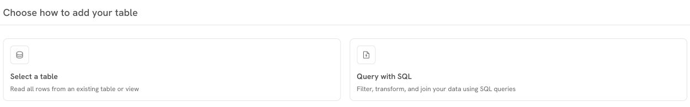

# Setting Up Events Table

Sortment allows you to track event-based data by adding **event tables** to your schema. These tables capture timestamped actions such as transfers, checkouts, or logins. Here's how to set up an events table (e.g., `FMS_TRANSFERS`) from your connected warehouse:

#### Adding an events table

Use an event table for actions you want to filter by time, such as an email delivery or a completed checkout.

1. Open the **Relations** canvas in the workspace where you want to use the events.
2. Open **Add table** and choose **Events**.

<figure><figcaption>
Step 1 of 2. Choose Events to add timestamped activity.
</figcaption></figure>

3. Choose how to add the data. For an existing warehouse table or view, choose **Select a table**. Choose **Query with SQL** if you need to filter, transform or join the source first.

<figure><figcaption>
Step 2 of 2. Choose the warehouse source for the event table.
</figcaption></figure>

4. For **Select a table**, choose the table or view you want to use and continue to the table details.

.png>)

5. Configure Table Details
   1. **Name your events table** – Pick a name that clearly describes the event (e.g., “Transfer Details”).
   2. **(Optional) Add a description** to help identify the table’s purpose.
   3. **Choose a primary key** – This should be a unique identifier for each event.
   4. **Select a timestamp** – This is required for event tables and represents when the event occurred.
   5. **Specify the event name** – This defines the type of event (e.g., `TRANSFER_COMPLETED`, `REFUND_INITIATED`).

Click **continue** to proceed.

7. Configure the following table properties for each column:
   1. **Visibility:** Turn a column on or off depending on whether you want to use it in Sortment.
   2. **Labels:** Sortment will autosuggest labels and descriptions for your table. Label the fields in your events table. These can be used to filter on events data in Audiences.
   3. **Descriptions** _(optional):_ Describe what your column contains.
   4. **Masked toggle**: Turn this on for sensitive information (e.g., personal identifiable data). Masked data will be protected and hidden by default in UI previews to comply with regulations and security.
   5. **Cached toggle**: Caching a column stores unique values from the column to make them accessible in the filter dropdowns.

8. Once you've configured all the necessary properties, click **“Save”** to finish adding your related table. The new table will now appear in your schema. Now let's define this table's relation to other tables already existing in your schema.

### Joining Tables

1. **Select the table** you want to work with (e.g. `User Information`).
2. Go to the relations tab to join the  `FMS_Transfers`  with  `User Information` .

<figure><figcaption></figcaption></figure>

3. Click **connect table** at the bottom.
4. In the join setup:

* Choose the **column from the current table** you want to join on (e.g. `Id` from `User Information`).
* Select the **join type** (`1:1`, `many:1`, etc.).
* Pick the **column from the target table** you want to join to (e.g. `FMS ORDER ID` from `FMS_Transfers`).

<figure><figcaption></figcaption></figure>

5. Once your configuration is complete, click **Save**.

This will link the data across tables based on the selected keys, enabling richer queries and insights.

### Can I build an audience using email activity from another workspace?

Yes, if the destination workspace can read the relevant events from your warehouse and match them to its users. Two workspaces with access to the same customer table can still have different event tables in their schemas.

1. Decide which event qualifies someone. For example, to follow up with people who received a product announcement, use a delivery event for that campaign. A send event answers a different question.
2. Have your data team make the permitted events available in a table or view that the destination workspace’s connection can read. Include an event ID, event time, event name, campaign identifier and a user identifier that matches the destination’s primary table.
3. In the destination workspace, add the source as an event table using the steps above. Connect it to the primary table on the shared user identifier.
4. Build the audience using the event, campaign and time window you need. Check a known test user who qualifies and one who should be excluded before using the audience.

If the table is missing from the picker, check the destination connection’s access. If the table appears but the audience is empty, check that the event and date range exist in the source and that the user identifiers match.
