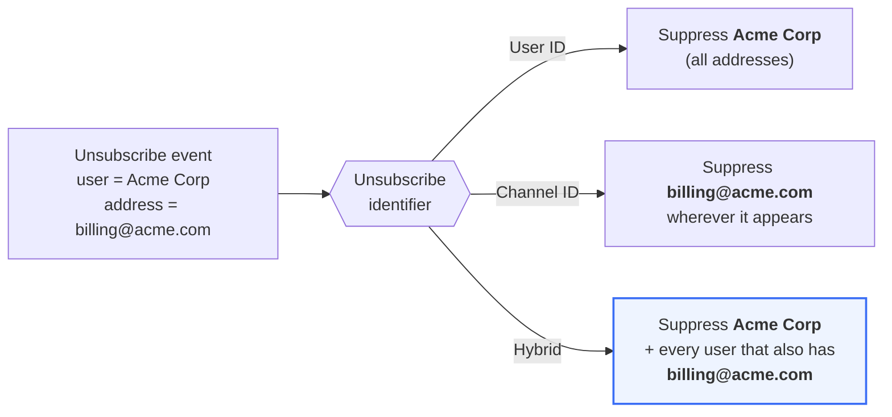
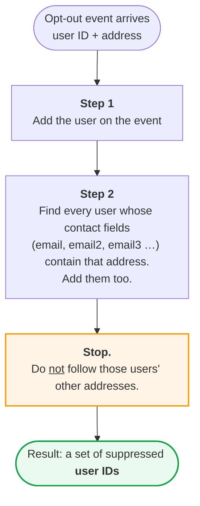
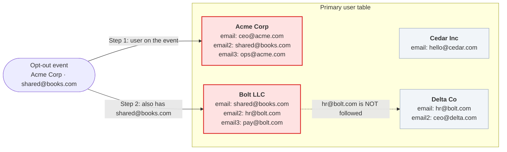
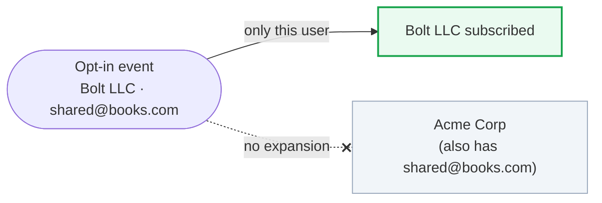
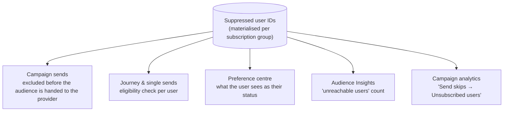
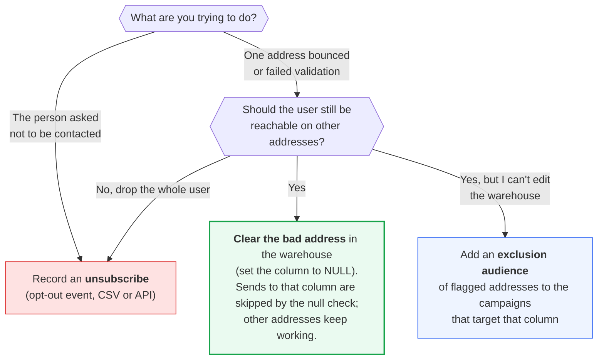

# Hybrid unsubscribe policy


**In one sentence:** under the Hybrid policy, an unsubscribe on **any one** email or phone number silences the **whole user** that address belongs to, plus any other user that shares that exact address. Opt‑ins are never shared.


## Why this exists

Many businesses store more than one way to reach the same user. A company record might carry a primary email, a billing email and an owner's personal email. A household might carry two phone numbers.

That raises a question every time someone unsubscribes:

> They unsubscribed using **one** address. Should we stop messaging the **user**, or just stop using **that address**?

Sortment lets each workspace answer this with an **unsubscribe identifier** setting. Hybrid is the setting for teams who want the user treated as one person, while still catching shared mailboxes.

## The three policies at a glance

| Policy | What the event is keyed on | Who gets suppressed | Best for |
| --- | --- | --- | --- |
| **User ID** | The user on the event | That user only, on every address | One address per user, or when consent is strictly personal |
| **Channel ID** | The address on the event | That exact address, on every user that has it | Address‑level consent, shared mailboxes, no reliable user ID |
| **Hybrid** | User **and** address | That user on every address, **and** every other user that has the same address | Multiple addresses per user **and** addresses that may be shared |


The policy is set **per workspace** and applies to every channel and every subscription group in it. Changing it after subscription groups exist requires regenerating the subscription materialisations. Ask your Sortment contact before switching.


## How Hybrid decides who to suppress

Hybrid runs a **one‑hop** expansion. Starting from the unsubscribe event, it takes exactly two steps and then stops.

Three things follow from this:

1. **Suppression is by user, not by address.** Once a user is in the set, none of their addresses receive the message, including addresses that were never unsubscribed.
2. **Shared addresses pull in other users.** If two records list the same email, an unsubscribe on that email suppresses both.
3. **There is no chain reaction.** Users pulled in through a shared address do not drag in further users through *their* other addresses.

## Worked example

Four company records, each with up to three email fields:

| User | Suppressed? | Why |
| --- | --- | --- |
| Acme Corp | 🔴 Yes, on **all three** emails | They are the user on the event |
| Bolt LLC | 🔴 Yes, on **all three** emails | They share `shared@books.com` (one hop) |
| Cedar Inc | 🟢 No | No shared address |
| Delta Co | 🟢 No | Shares `hr@bolt.com` with Bolt, but that is a **second** hop |


**Contrast with a personal address.** If Acme unsubscribed via `ceo@acme.com` instead, only Acme would be suppressed, because nobody else has that address. Acme would still be suppressed on all three of its emails.


## Opt‑in groups behave differently

The one‑hop expansion applies to **opt‑out** groups only. For **opt‑in** groups, Hybrid behaves exactly like User ID: consent is personal and is never inferred for another user just because they share an address.

## Where the policy is applied

The same suppression set is used everywhere Sortment checks whether someone can be messaged, so results are consistent.


In the campaign **Send skips** panel, the *Total / Global / Subscription group unsubscribed users* rows are computed with this same policy. A user suppressed through a shared address will appear there even though they never clicked unsubscribe themselves.


## Setup requirements

Hybrid depends on knowing which fields hold contact details. These come from **Contact Fields** in workspace settings. See [Subscription Groups and Contact Fields](subscription-groups-and-contact-fields.md).

| Requirement | Detail |
| --- | --- |
| Contact Fields configured per channel | Primary field plus any secondary fields, e.g. `email`, `email2`, `email3` for email |
| Fields live on the **primary user table** | Fields on joined tables are not supported for Hybrid |
| Exact matching | `Billing@Acme.com` and `billing@acme.com` are **different** addresses. Normalise case and whitespace in your warehouse |
| Bulk CSV uploads need **both** columns | `user_id` **and** `channel_id` are required when the workspace is on Hybrid. See [Bulk Unsubscribe](../how-to-guides/bulk-unsubscribe.md) |
| Regenerate after changing Contact Fields | Adding or removing a contact field requires rebuilding subscription materialisations |


The [Bulk Unsubscribe](../how-to-guides/bulk-unsubscribe.md) guide describes uploading **either** `channel_id` **or** `user_id`. That applies to the User ID and Channel ID policies. On Hybrid the CSV must contain **both** columns, and every row suppresses the named user on all of their addresses.


## Choosing the right tool for data hygiene

Because Hybrid suppresses the **whole user**, an unsubscribe is a blunt instrument for cleaning up a single bad address. Use the decision tree below.


**Do not upload email‑validation results (bounces, invalid, spam‑trap) as unsubscribes** unless you intend to stop contacting the entire user. Under Hybrid each row will suppress the named user on every address, and any other user sharing that address.


## Quick reference

| Scenario | User ID | Channel ID | Hybrid |
| --- | --- | --- | --- |
| Acme unsubscribes via its billing email | Acme suppressed on all emails | Only the billing email suppressed, on every user that has it | Acme on all emails **+** every user with that billing email |
| Two companies share one mailbox; one unsubscribes | Only the unsubscribing company | Both, but only on that mailbox | Both, on **all** their emails |
| A single address bounces | Whole user suppressed if recorded as opt‑out | Only that address | Whole user suppressed, so prefer clearing the column instead |
| Someone opts **in** via a shared address | Only that user | Only that address | Only that user (no expansion) |

## FAQ

Does Hybrid chain across several shared addresses?

No. It stops after one hop. A user pulled in through a shared address does not pull in further users through their other addresses.

We only have one email field. Does Hybrid change anything?

Only for shared addresses. With a single field and no duplicates, Hybrid behaves like User ID.

Can I switch from User ID to Hybrid?

Yes, but it requires Contact Fields to be configured for every channel you message on, and subscription materialisations to be regenerated. Contact Sortment support to schedule the switch.

How do I see who was suppressed and why?

Open the campaign, click **View reasons** next to *Send skips*. The *Unsubscribed users* rows reflect this policy. For a single user, the Preference centre shows their status per subscription group.

## Related

* [Subscription Groups and Contact Fields](subscription-groups-and-contact-fields.md)
* [Bulk Unsubscribe](../how-to-guides/bulk-unsubscribe.md)
* [Delivery Controls](delivery-controls.md)
