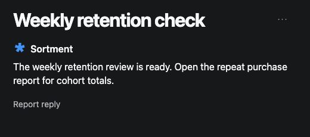
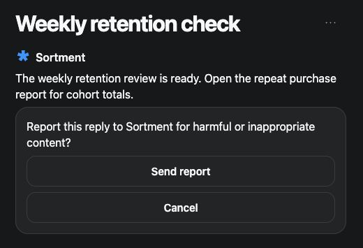

# Manage mobile AI permission and account requests

In [Sortment for mobile](https://chat.sortment.com/mobile/), you can review AI data sharing, report an assistant reply, and request deletion of your Sortment account.

## Review permission before sending to AI

Before your first chat message or quest reply in a workspace session, Sortment shows **Share with AI providers?**. The notice explains that your message, relevant conversation history, and workspace records can be sent to third-party AI providers. Those records can include personal information.

Read the notice and choose:

* **Allow and send** to give permission for this workspace session and send the pending message or reply.
* **Cancel** to return to your form without sending it.

Browsing the workspace and using the built-in sample do not require this permission.

### Withdraw permission

1. Open the workspace menu by selecting the workspace name and initials at the top of the screen.
2. Select **App settings**.
3. Under **AI data sharing**, select **Withdraw AI permission**.

This control appears after you have allowed sharing in the current workspace session. Your next AI message or quest reply asks for permission again. Withdrawing permission does not delete earlier messages or records already sent.

## Report an assistant reply

Use reporting for harmful or inappropriate content in an assistant reply you can read.

1. Open the conversation under **Chats**.
2. Select **Report reply** beneath the assistant's reply.
3. Read the confirmation, then select **Send report**. Select **Cancel** if you do not want to submit it.

After a successful submission, **Reported to Sortment.** appears. If you see **Couldn’t send your report. Please try again.**, retry the submission or contact [support](../getting-started/contact-us.md).

The screenshot sequence below uses the built-in sample workspace. It shows where to open reporting and the confirmation before submission.

<figure><figcaption>
1. Select Report reply beneath the response.
</figcaption></figure>

<figure><figcaption>
2. Review the confirmation before sending a report.
</figcaption></figure>

## Request account deletion

Use this when you want Sortment to review a request to permanently delete your account and associated personal data. Shared workspace ownership may need to be handled before the account can be removed.

1. Sign in with the account you want to manage.
2. Open the workspace menu, then **App settings**.
3. Select **Request account deletion** and read the confirmation.
4. Select **Confirm deletion request** to submit it, or **Cancel** to keep your account as it is.

The message **Deletion request received. Sortment will follow up at your account email.** confirms receipt of the request. It does not mean deletion has finished.

You can also open [account management](https://chat.sortment.com/mobile/?account=delete) directly, including when you have no workspace selected. You must sign in with the account you want to manage. If you have lost access, use the contact link on the [mobile support page](https://chat.sortment.com/mobile/support.html).

See the [Privacy Policy](../data-and-security/privacy-policy.md) for retention information and your rights.
