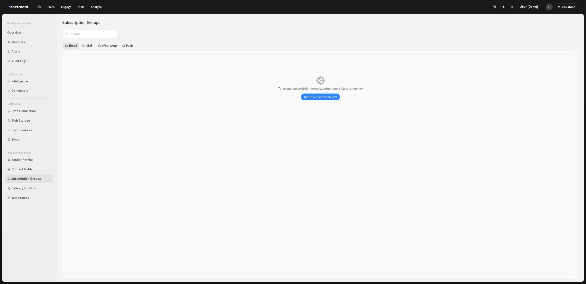

# Subscription Groups And Contact Fields

**Subscription groups** in Sortment allow you to organize your email communications into distinct groups, giving users greater control over the types of emails they receive.

It also empower recipients to manage their email preferences based on interest or intent.

For example, you can create a subscription group specifically for **newsletter emails**. If a user opts out of this group, they’ll stop receiving newsletters but can still receive **order updates**, **promotions**, or other types of emails they're subscribed to.

**Types of Subscription Group**

* **Opt-in**: Users need to manually subscribe to receive messages from the group.
* **Opt-out**: Users are automatically subscribed but have the option to unsubscribe.
* **Required**: Users cannot unsubscribe from the group, often used for essential communications like account updates.

### Can someone receive a bulk email after unsubscribing from the email channel?

Yes, if the campaign uses a **Required** subscription group. A channel-wide email unsubscribe excludes a user from bulk **Opt-in** and **Opt-out** group campaigns. It does not, by itself, exclude that user from a bulk **Required** group campaign.

For example, someone who opted out of all marketing email should be excluded from a newsletter sent with an Opt-out group. The same person can still be eligible for an essential account notice sent with a Required group. Selecting Required does not resubscribe the person to the newsletter or guarantee that the notice is delivered. Workspace [suppression rules](delivery-controls.md#suppression-rules) still apply.

**To investigate an unexpected send:**

1. Check the channel and subscription group on the campaign that sent the message. Open **Workspace Settings → Subscription Groups** and select **Email** to check the group type.
2. Distinguish an unsubscribe from one group from an unsubscribe from the entire email channel. Compare the preference change with the time of the campaign run.
3. If the user has multiple addresses or shares an address with another user, check which [unsubscribe identifier policy](hybrid-unsubscribe-policy.md) your workspace uses.
4. If the result still does not match the group type and preferences, give Sortment support the campaign, run time and timezone, and the group type. Keep recipient details out of shared screenshots.


Choose **Required** only for messages your team has classified as essential. Do not change a marketing campaign to Required to reach someone who opted out.


### Does reopening an email preference link resubscribe someone?

No. If a recipient selects **Unsubscribe from all**, the hosted preference page confirms that they’ve unsubscribed from email. When they reopen the **manage preferences** link in their email, they see the list of groups again. Optional groups appear unchecked. Opening the list does not change their preferences.

For example, if a recipient wants the newsletter again, they can select the newsletter group and choose **Save preferences**. Saving a change also lifts the channel-wide email opt-out. A recipient who wants to keep that opt-out can simply close the page.

#### **How Subscription Groups Work in Sortment**

* When sending an **email campaign**, you can assign it to a subscription group.
* **Email templates** include **subscription links**—such as _unsubscribe_ and _manage preferences_—allowing users to update their preferences at any time.
* If a recipient has **unsubscribed** from that group, they will be **automatically excluded** from futures campaigns sent in that subscription group.
* You can view and update user’s subscription preferences from their **customer profile**.&#x20;
* If a user is excluded due to their subscription status, the count for subscription related audience exclusion is updated in campaign reports.

#### **How to Bulk Unsubscribe users**

* You can bulk unsubscribe users by selecting "Import Unsubscribers" at a global channel level (separate lists for Email, SMS, Whatsapp), and uploading a CSV formatted as per the CSV file available on screen.
* You can also unsubscribe users at a subscription group level by selecting the 'Unsubscribe users' option in the drop down menu next to the subscription group, and uploading a CSV formatted as per the CSV file available on screen.

&#x20;

### **Category**

A **category** is a broader organizational structure used to group related **subscription groups** together for better management and user experience. Categories allow for a cleaner and more organized presentation of subscription options on the user's preference or unsubscribe page.

**Example**:

A category named "Product Notifications" might contain subscription groups like "Updates", "Release Announcements", and "Bug Fixes".

* A category named "Product Notifications" might contain subscription groups like "Updates", "Release Announcements", and "Bug Fixes".
* A category named "Promotions" could house groups like "Sales", "Holiday Offers", and "New Arrivals".

### **How to Access and Create Subscription Groups**

#### **Navigating to Subscription Groups**

1. Go to the **Settings** section in your Sortment dashboard.
2. Click on **Subscription Groups**.
3. Select the relevant channel: **Email**, **SMS**, **WhatsApp**, or **Push**. If the page shows **Setup subscription key** instead of your groups, a workspace administrator can configure the [unsubscribe identifier](hybrid-unsubscribe-policy.md) before creating a group. This setting applies across the workspace.

<figure><figcaption>
The manager shows this prompt when the workspace needs an unsubscribe identifier.
</figcaption></figure>

***

#### **Creating a Subscription Group**

1. Select the channel tab (**Email**, **SMS**, or **WhatsApp**) where you want to create the group.
2. Click **New Group**.
3. Fill in the following details:
   * **Name**: The title shown to users (e.g., “Newsletters”).
   * **Description**: A short explanation of what emails/messages the group includes.
   * **Category**: Choose from an existing category or create a new one to help users navigate their preferences.
   * **Type**: Select one of the following:
     * **Opt-in** – Users subscribe manually.
     * **Opt-out** – Users are subscribed by default but can unsubscribe.
     * **Required** – Users cannot unsubscribe (used for essential messages).
4. Click **Save Group** to finish.

***

**User Representation on Unsubscribe Page**

The order and structure you see on the Subscription Groups Manager page is exactly how it will appear to users when they visit the unsubscribe page. Organizing and categorizing your groups will directly influence the user experience when managing their preferences.

***

### **Contact Fields**

Defines the channels and identifiers used to contact a user against that channel (Email, SMS, WhatsApp). Since Sortment operates on your data warehouse, it allows you to have multiple contact fields against same user for a given channel.

#### How to setup contact fields

* Navigate to respective channel tab under Contact Fields in workspace settings.
* Click "Add" button to add primary contact field.
* You can **add more contact fields** via the “Add another” button.

The primary contact field for each channel is use to calculate reachability, by removing users who do not have a value available in the column (null). This is available under Insights during audience creation.
