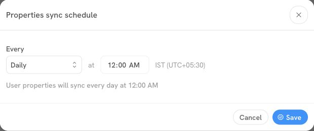

# Sync Schedules

Sync schedules in Sortment control **how often data is refreshed** from your data warehouse for journey-related use cases. This ensures your segmentation, personalization, and analytics remain accurately available across all communications.

***

#### 5.1 Overview

* Find **User Properties Sync** under **Workspace Settings → Syncs**.
* They define the **frequency and time** when user properties are automatically synced from integrated data sources.
* You can choose between **Daily**, **Weekly**, or **Monthly** syncs, and configure the exact time and date.
* The system time zone is displayed (e.g., IST UTC+05:30), ensuring clarity across teams.

***

#### 5.2 How to Modify a Sync Schedule

1. Open **Workspace Settings → Syncs**.
2. Next to **User Properties Sync**, select **Create** for a new schedule or **Edit** for an existing one.
3. Under **Every**, choose the frequency. Set the day if prompted, then the time. Check the timezone and the schedule summary.
4. Select **Save** to apply the schedule.

<figure><figcaption>
The summary shows when user properties will sync in the displayed timezone.
</figcaption></figure>

#### Why is a cached user property still showing an older value after journey events update?

Sortment can reuse the last cached property values when it updates journey events. It schedules another property refresh only after the minimum interval has passed since the last run. For example, with a four-hour minimum, a cache refreshed at 09:00 can be reused when events update at 10:00. The first event update at or after 13:00 can schedule the next refresh.

Check when the new value appeared in your warehouse and compare it with your **User Properties Sync** schedule. If the value remains stale after the expected sync, include the property name, source update time and timezone when contacting support.

***

#### 5.3 Best Practices

* **Align sync times** with your data warehouse refreshes (e.g., after daily ETL jobs complete)
* Avoid scheduling during peak business hours to minimize API load or warehouse strain
