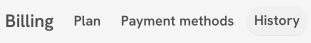

# Find your workspace invoices and payment receipts

If your workspace has a **Billing** section, open it from **Workspace settings** in the workspace that was billed. Each workspace has its own plan, invoices and payment history.

* **Plan** shows the current plan and usage. Check **Billing owner** and **Invoice recipients** to see who receives billing emails.
* **Payment methods** shows the cards saved for this workspace.
* **History** lists invoices and payments. Workspace admins and members with the **Billing** role can open this tab. If you can see only **Plan**, ask a workspace admin or Billing member for the document you need.

<figure><figcaption>
Select History to find invoices and receipts.
</figcaption></figure>

## Download an invoice or open a receipt

1. In **Billing**, select **History**.
2. Under **Invoices**, find the billing period you need. Select **View** to open the invoice or **Download PDF** if a PDF is available. The list shows the workspace’s 12 most recent invoices.
3. For proof of a payment, look under **Payments**. Find the payment and select **View receipt** if a receipt is available.

If an invoice is missing, check the selected workspace and the billing period. For an older invoice, check the billing owner’s or invoice recipient’s email. An invoice and a payment receipt are separate documents.
