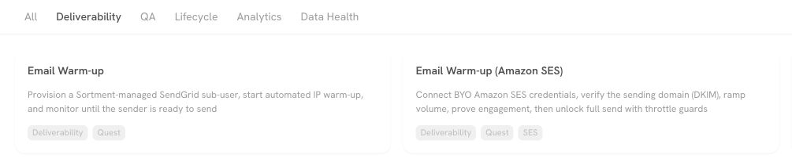

# Choose an email warm-up Quest

Use an email warm-up Quest to set up a sender and follow its warm-up progress. The template picker offers a Sortment-managed SendGrid option and an option for your own Amazon SES account.

## Choose the right option

| Template | Use it when | Prepare before starting |
| --- | --- | --- |
| **Email Warm-up** | You want Sortment to provision a managed SendGrid sub-user and dedicated IP. | The sender name and email address, and confirmation that managed warm-up is enabled for your workspace. |
| **Email Warm-up (Amazon SES)** | You want to use your own Amazon SES account and sending domain. | A sender profile in the current workspace, AWS access credentials, the AWS region, and access to the domain's DNS settings. |

<figure><figcaption>
The two warm-up options in the Deliverability tab.
</figcaption></figure>

You need an **Admin** or **Marketer** role to enroll. If a warm-up option is missing or unavailable, [contact support](../getting-started/contact-us.md) to check availability for your workspace.

For SES, use the credentials requested by the warm-up form: **AWS access key ID**, **AWS secret access key**, and **AWS region**. An SES SMTP password is different from an AWS secret access key. Ask your AWS administrator to prepare the appropriate credentials; see [Amazon's credential guidance](https://docs.aws.amazon.com/ses/latest/dg/smtp-credentials.html).

## Find the warm-up templates

1. Open **Plan → Quests**.
2. Click **New**.
3. Choose **Deliverability** in the template picker.
4. Select the warm-up option for your provider and review its setup form. For SES, check that **Sender email** identifies the sender profile you intend to use.


Starting a warm-up Quest creates provider resources and begins an active enrollment. Review the workspace, sender and provider before choosing **Start warm-up quest** or **Start SES warm-up quest**.


After a successful enrollment, Sortment opens the monitoring Quest. For SES, enrollment starts domain verification; follow the DKIM instructions for the selected sending domain before attempting to publish email campaigns.

## Why can't I start or publish?

**Managed SendGrid warm-up is not configured.** Contact support with your workspace name and the error message. Configuration of the managed service needs to be completed before you can enroll.

**No sender profiles found.** Check the current workspace and its **Settings → Sender profiles**. The SES form also provides **Create a new sender profile**. Select a profile whose sender address uses the domain you intend to verify.

**The SES domain is not verified.** Check the sending domain and its DKIM records with the person who manages your DNS. Publishing can remain blocked while verification is pending.

**The SES warm-up daily cap has been reached.** Check the cap and progress for the active enrollment. The daily counter uses UTC. Wait for the next daily window, and contact support if the displayed state is unexpected; retrying Publish does not increase the cap.

**The SES warm-up throttle is paused.** Review the reported bounce or complaint problem with your deliverability team before publishing again. Contact support if the cause or recovery step is unclear.

An active SES warm-up enrollment can block publishing email campaigns in its workspace. Selecting another sender does not necessarily avoid that workspace check.

## Does warm-up completion mean I can send without limits?

No. Review the Quest's current state, your provider account and your campaign settings before sending. A warm-up state is not a guarantee of inbox placement or permission to send to every recipient.

For Amazon SES, sandbox restrictions and sending quotas still apply in the selected AWS region. Leaving Sortment's warm-up stage does not move an SES account out of the sandbox. See [Amazon's production-access guidance](https://docs.aws.amazon.com/ses/latest/dg/request-production-access.html).

For ordinary provider setup, see [SendGrid](../email/sendgrid.md) and [Amazon SES](../email/ses-amazon-simple-email-service.md). To compare Quests with scheduled Tasks and customer journeys, see [Quest, Task, or Journey?](../faq/quest-task-or-journey.md).
